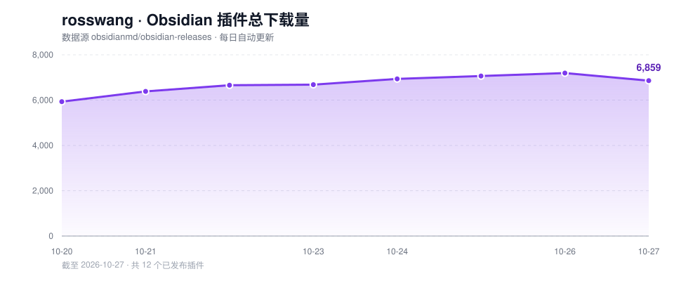

# rosswang 的 Obsidian 插件下载统计

每天自动抓取 [Obsidian 社区插件市场](https://community.obsidian.md/) 中作者为 `rosswang` 的**已发布**插件下载量，累计后生成趋势图。



**总下载量：6,683** · 10 个已发布插件 · 更新于 2026-10-23 13:47（Asia/Shanghai）

## 插件列表（仅已发布）

| 插件 | 市场页面 | GitHub 仓库 | 下载量 | 一句话说明 |
| --- | --- | --- | ---: | --- |
| **MD to HTML Effectiveness**<br>`md-to-html-effect` | [市场](https://community.obsidian.md/plugins/md-to-html-effect) | [yanqingwang/obsidian-md-to-html-effect](https://github.com/yanqingwang/obsidian-md-to-html-effect) | 2,360 | 把 Markdown 渲染成可缩放、可导出的空间化 HTML（对比、时间线、SVG 图、报告、幻灯片）。 |
| **HTML Effectiveness**<br>`html-effectiveness` | [市场](https://community.obsidian.md/plugins/html-effectiveness) | [yanqingwang/obsidian-html-effectiveness](https://github.com/yanqingwang/obsidian-html-effectiveness) | 1,800 | 在 Obsidian 中直接渲染对比、流程图、幻灯片、报告、时间线等空间化 HTML 内容。 |
| **HTML to MD Effectiveness**<br>`html-to-md-effect` | [市场](https://community.obsidian.md/plugins/html-to-md-effect) | [yanqingwang/obsidian-html-to-md-effect](https://github.com/yanqingwang/obsidian-html-to-md-effect) | 1,153 | 把 HTML 文件转换成干净的 Markdown，保留标题、列表、代码块、表格、链接和图片。 |
| **Nextcloud sync YANC**<br>`nextcloud-sync-yanc` | [市场](https://community.obsidian.md/plugins/nextcloud-sync-yanc) | [yanqingwang/obsidian-nextcloud-sync-yanc](https://github.com/yanqingwang/obsidian-nextcloud-sync-yanc) | 505 | 在 Obsidian vault 与 Nextcloud 之间双向同步，支持智能/强制模式、分块上传和隐藏文件排除。 |
| **Vault Agent**<br>`vault-agent` | [市场](https://community.obsidian.md/plugins/vault-agent) | [yanqingwang/opensource-AI-vault-agent](https://github.com/yanqingwang/opensource-AI-vault-agent) | 409 | AI vault agent powered by China-accessible LLM APIs — DeepSeek, GLM, Kimi, Qwen or any OpenAI-compatible endpoint. Agentic read/search/create/edit of notes. No CLI, no proxy, 中文优先. |
| **Joplin Server Sync**<br>`joplin-server-sync` | [市场](https://community.obsidian.md/plugins/joplin-server-sync) | [yanqingwang/obsidian-joplin-server-sync](https://github.com/yanqingwang/obsidian-joplin-server-sync) | 358 | 在 Obsidian vault 与 Joplin Server 之间双向同步，支持附件、标签和链接。 |
| **Quadrant Chart**<br>`quadrant-chart` | [市场](https://community.obsidian.md/plugins/quadrant-chart) | [yanqingwang/quadrant-chart](https://github.com/yanqingwang/quadrant-chart) | 42 | 用纯 YAML 的 .mdx 文件绘制带自由文本的 N×M 象限图。 |
| **Embed Link Converter**<br>`embed-link-converter` | [市场](https://community.obsidian.md/plugins/embed-link-converter) | [yanqingwang/obsidian-embed-link-converter](https://github.com/yanqingwang/obsidian-embed-link-converter) | 28 | 在 Obsidian wiki-link 嵌入与 Markdown 图片语法之间双向转换，支持文件夹范围、预览和自动备份。 |
| **Clear Unused Attachments**<br>`clear-unused-attachments` | [市场](https://community.obsidian.md/plugins/clear-unused-attachments) | [yanqingwang/Clean_unused_attachments_selectable](https://github.com/yanqingwang/Clean_unused_attachments_selectable) | 24 | 按文件夹和文件类型筛选并清理未使用的图片和附件。 |
| **Theme View Studio**<br>`theme-view-studio` | [市场](https://community.obsidian.md/plugins/theme-view-studio) | [yanqingwang/obsidian-theme-view-studio](https://github.com/yanqingwang/obsidian-theme-view-studio) | 4 | Folder-scoped appearance: reading width, typography, background image and opacity, transparency, and an e-ink mode. One default theme for the vault, different looks per folder. |
| **合计** | | | **6,683** | |

> 下载量来自 Obsidian 官方仓库的 `community-plugin-stats.json`；插件是否发布以 `community-plugins.json` 为准，未上架/已下架插件不会出现在表中。

## 数据文件

- `data/history.json`：每日快照（总量 + 各插件下载量），用于绘制趋势图
- `chart.svg`：总下载量趋势图
- `fetch_stats.py`：抓取与生成脚本（仅用 Python 标准库）

## 自动化

GitHub Actions 每天 UTC 01:00（北京时间 09:00）运行一次，更新 `README.md`、`chart.svg` 和 `data/history.json` 并自动提交。

本地运行：

```bash
python fetch_stats.py
```
